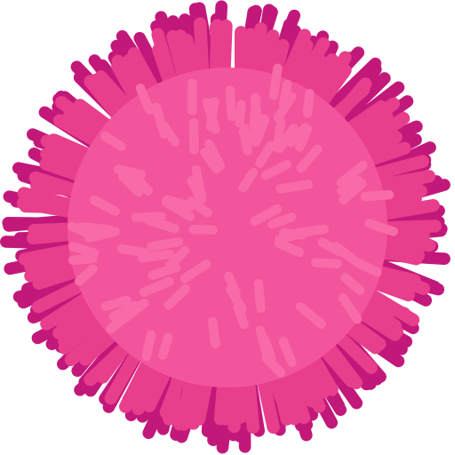

<p align="center"></p>

# fuzzball

Encoder and decoder for the **Fuzzball** terminal protocol, the DCS `Fz` extension
family first implemented in the [Mouser](https://github.com/WeirdBrains/mouser) terminal.
Website: <https://weirdbrains.github.io/fuzzball/>

```text
ESC P = F z <subsystem> <verb> ; <params> [: <payload>] ESC \
```

- **Keyboard** (`k`): one opt-in mode of structured key events (physical key, logical key,
  modifiers, locks, text, IME).
- **Graphics** (`g`): image upload (chunked base64), cell-anchored placements, delete, query.
- **Shell actions** (`s`): silent `cd` for shell integrations.
- **Plugins** (`p`) and the **common** capability query (`c`).

No dependencies, no I/O, no terminal library: bring your own reader and writer.

```toml
[dependencies]
fuzzball = "1"
```

## Key events

```rust
use fuzzball::{Decoder, Item};
use fuzzball::keyboard::{self, KeyEvent};

// Turn the mode on (write this to the terminal).
let enable: &[u8] = keyboard::ENABLE; // ESC P = F z k s ; on=1,v=0 ESC \

// Feed input as it arrives; partial messages are held until complete.
let mut d = Decoder::new();
d.push(b"\x1bP=Fzke;t=p,code=KeyA,key=U+0061,text=61\x1b\\");
while let Some(item) = d.next() {
    match item {
        Item::Message(m) => {
            if let Some(ev) = KeyEvent::from_message(&m) {
                println!("{:?} {:?} {:?}", ev.kind, ev.key, ev.text);
            }
        }
        Item::Text(other) => { /* hand to your normal input parser */ let _ = other; }
        _ => {}
    }
}
```

`keyboard::parse_event(buf, max)` parses one event at the start of a buffer and reports
`Incomplete`, `Invalid { len }` or `NotFuzzball`, for parsers that manage their own
buffer (such as crossterm's).

## Detection

Send `common::detect_query(1)` (capability query followed by DA1). A Fuzzball terminal
answers `c r` before the DA1 reply; read it with `common::Capabilities::from_message` and
check `keyboard()` or `has_subsystem('g')`.

## Specification

The protocol is specified in [`docs/`](docs/): [README](docs/README.md) (framing,
negotiation, errors), [keyboard](docs/keyboard.md), [graphics](docs/graphics.md),
[shell](docs/shell.md), [plugins](docs/plugins.md). [`docs/wire-format.md`](docs/wire-format.md)
records exactly what implementations emit today, where it is more specific than the
v0.1 drafts.

## Stability

1.x keeps the wire format and API compatible. Golden-byte tests in `tests/golden.rs`
lock every message this crate writes. MSRV: Rust 1.85.

## License

BSD-3-Clause, Copyright (c) 2026 Weird Brains.
